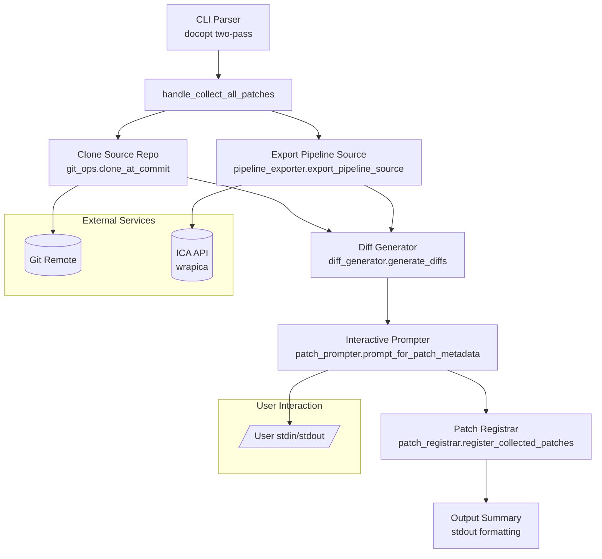

# Design Document: collect-all-patches

## Overview

The `collect-all-patches` subcommand reverse-engineers patches from an ICA pipeline by comparing its source files against the original git repository at a specific commit. It produces content-addressed unified diff patches compatible with the existing nf-ica patch system, enabling users to replicate pipeline customisations as a reproducible patch set.

The command orchestrates four phases:
1. **Clone** the source repository at a specific commit
2. **Export** the ICA pipeline source files via wrapica
3. **Diff** the two directory trees to produce unified patches
4. **Register** each patch in the content-addressed storage system

## Architecture



**Design Decisions:**

1. **Reuse existing infrastructure** — `clone_at_commit`, `compute_md5`, and `register_patch` are already battle-tested. The handler delegates to them rather than reimplementing.
2. **Separate modules for testability** — The diff generation and slug suggestion logic are pure functions extracted into their own modules, making them suitable for property-based testing. The interactive prompting is isolated in `patch_prompter.py` for easy mocking in tests.
3. **Interactive patch naming** — Rather than auto-generating patch names, the user is prompted for each patch's name and description. A suggested name is provided as a default (based on the workflow identifier and file path slug), but the user has full control. This ensures meaningful names and descriptions in the registry.
4. **wrapica's `download_pipeline_to_directory`** — This function handles listing and downloading all pipeline files with correct directory structure. We use it directly via the `wrapica.pipelines` module rather than managing individual file downloads.
5. **`git diff --no-index`** — Used for diff generation because it produces unified diffs that are directly compatible with `git apply`, matching the existing patch application infrastructure.

## Components and Interfaces

### 1. CLI Integration (`nf_ica_cli/cli.py`)

Add the `collect-all-patches` subcommand to the CLI's two-pass docopt system:

```python
# New usage string added to _SUBCMD_USAGE
"collect-all-patches": """Collect patches from an ICA pipeline by diffing against source.

Usage:
    nf-ica collect-all-patches
        (--repo-uri=<uri>)
        (--commit-id=<id>)
        (--project-id=<pid>)
        (--pipeline-id=<plid>)

Options:
    --repo-uri=<uri>       Git repository URI for the original workflow source
    --commit-id=<id>       Git commit SHA to compare against
    --project-id=<pid>     ICA project UUID containing the pipeline
    --pipeline-id=<plid>   ICA pipeline UUID to export source from
    -h --help              Show this help message
"""
```

Dispatch follows the existing pattern — lazy import of the handler after docopt succeeds.

### 2. Handler (`nf_ica_cli/handlers/collect_all_patches.py`)

```python
def handle_collect_all_patches(args: dict, config: AppConfig, config_repo: Path) -> None:
    """
    Orchestrates: validate args → check token → clone repo → export pipeline →
    generate diffs → register patches → print summary.
    
    Uses tempfile.mkdtemp for both clone and export directories.
    Cleanup via try/finally to ensure removal on success or error.
    """
```

**Flow:**
1. Extract `--repo-uri`, `--commit-id`, `--project-id`, `--pipeline-id` from args
2. Validate `ICAV2_ACCESS_TOKEN` is set (fail-fast before any network calls)
3. Clone source repo into temp dir via `clone_at_commit`
4. Export pipeline source into temp dir via `export_pipeline_source`
5. Generate diffs via `generate_diffs`
6. If no diffs: print "no patches generated" message and return
7. For each diff, interactively prompt user for name/description via `prompt_for_patch_metadata`
   - Show the relative file path and a reference to the patch file location
   - Notify user if patch content (MD5) already exists in registry
   - User can accept suggested name, provide custom name, or skip
8. Register non-skipped patches via `register_collected_patches`
9. Print summary to stdout (registered patches, skipped patches, duplicates)
10. Cleanup temp directories (in finally block)

### 3. Pipeline Exporter (`nf_ica_cli/pipeline_exporter.py`)

```python
def export_pipeline_source(
    project_id: str,
    pipeline_id: str,
    output_dir: Path,
) -> None:
    """Download all pipeline source files from ICA into output_dir.
    
    Uses wrapica.pipelines.download_pipeline_to_directory which:
    - Lists all pipeline files via list_pipeline_files(pipeline_id)
    - Downloads each file preserving relative paths
    
    Validates ICAV2_ACCESS_TOKEN is available before calling wrapica.
    Wraps wrapica ApiException into RuntimeError with context.
    """
```

**Why a separate module?** Encapsulates the wrapica dependency and authentication checks, keeping the handler testable with simple mocks.

### 4. Diff Generator (`nf_ica_cli/diff_generator.py`)

```python
def generate_diffs(
    source_dir: Path,
    pipeline_dir: Path,
) -> List[FileDiff]:
    """Generate unified diffs between source and pipeline directories.
    
    Returns:
        List of FileDiff objects ordered alphabetically by relative_path.
        Empty list if directories are identical.
    """

@dataclass
class FileDiff:
    """A single file's unified diff."""
    relative_path: str   # e.g. "conf/ica.config"
    diff_content: str    # Full unified diff text
    is_new_file: bool    # True if file only exists in pipeline
    is_deleted: bool     # True if file only exists in source

def generate_single_file_diff(
    source_file: Optional[Path],
    pipeline_file: Optional[Path],
    relative_path: str,
    source_dir: Path,
    pipeline_dir: Path,
) -> Optional[str]:
    """Generate unified diff for a single file pair using git diff --no-index.
    
    Returns None if files are identical.
    Raises RuntimeError if git diff exits with code other than 0 or 1.
    """

def collect_file_paths(
    source_dir: Path,
    pipeline_dir: Path,
) -> List[str]:
    """Collect the union of all relative file paths from both directories.
    
    Excludes .git/ directory contents.
    Returns sorted list of relative paths.
    """
```

**Design rationale:**
- `collect_file_paths` is a pure function that computes the union of file paths, excluding `.git/`
- `generate_single_file_diff` wraps `git diff --no-index` for one file pair
- The main `generate_diffs` orchestrates: collect paths → diff each → filter None → sort → return

### 5. Interactive Patch Prompter (`nf_ica_cli/patch_prompter.py`)

```python
@dataclass
class PatchPromptResult:
    """User-provided metadata for a collected patch."""
    name: str
    description: str
    skip: bool  # True if user chose to skip this patch

def prompt_for_patch_metadata(
    relative_path: str,
    patch_file_path: Path,
    existing_patches: List[PatchEntry],
    md5sum: str,
) -> PatchPromptResult:
    """Interactively prompt the user for patch name and description.
    
    Displays:
    - The relative file path that changed
    - A reference to the patch file (patches/<md5sum>.txt)
    - Whether this patch already exists in the registry (by MD5 match)
    
    If MD5 matches an existing patch, notifies the user and asks whether
    to skip or register under a new name.
    
    Prompts:
    - "Patch name: " (validated against [a-zA-Z0-9_-]+ pattern)
    - "Description: " (free-text, required non-empty)
    
    Returns PatchPromptResult with user's choices.
    Raises SystemExit if stdin is not a TTY (non-interactive mode).
    """

def suggest_patch_name(
    workflow_identifier: str,
    relative_path: str,
) -> str:
    """Generate a suggested patch name for the user prompt.
    
    Pattern: <workflow_identifier>_<slug>
    Slug rules:
    1. Remove file extension
    2. Replace path separators (/ and \\) with underscore
    3. Replace any character not matching [a-zA-Z0-9_-] with underscore
    4. Collapse consecutive underscores into single underscore
    
    The suggested name is shown to the user who can accept or override it.
    """

def validate_patch_name_available(
    name: str,
    existing_names: Set[str],
) -> bool:
    """Check if a name is valid and not already taken.
    
    Returns True if valid and available.
    Prints error message and returns False if invalid or taken.
    """
```

The prompter uses `input()` for interactive collection. The suggested name is shown as a default that the user can accept by pressing Enter or override by typing a new name.

### 6. Patch Registrar (`nf_ica_cli/patch_registrar.py`)

```python
@dataclass
class CollectedPatch:
    """Result of registering a collected patch."""
    name: str
    description: str
    relative_path: str
    md5sum: str
    is_new: bool  # False if MD5 already existed in registry
    was_skipped: bool  # True if user chose to skip (existing duplicate)

def register_collected_patches(
    diffs: List[FileDiff],
    workflow_identifier: str,
    config_repo: Path,
    existing_patches: List[PatchEntry],
) -> List[CollectedPatch]:
    """Register collected diffs as patches with interactive user prompting.
    
    For each diff:
    1. Write diff content to a temp file
    2. Compute MD5 of the diff content
    3. Check if MD5 already exists in registry — notify user if so
    4. Prompt user for name and description (with suggested default)
    5. If user chooses to skip, record as skipped
    6. Otherwise, call register_patch to store file and update registry
    7. Update patches.yaml
    
    Returns list of CollectedPatch results for summary output.
    """
```

## Data Models

### FileDiff

```python
@dataclass
class FileDiff:
    """Represents a unified diff for a single file."""
    relative_path: str    # Relative path from directory root (e.g. "conf/ica.config")
    diff_content: str     # Full unified diff text compatible with git apply
    is_new_file: bool     # File exists only in pipeline source
    is_deleted: bool      # File exists only in source repo
```

### CollectedPatch

```python
@dataclass
class CollectedPatch:
    """Result of registering one collected patch."""
    name: str             # User-provided patch name (e.g. "myworkflow_ica_config_patch")
    description: str      # User-provided description
    relative_path: str    # Original file path that was diffed
    md5sum: str           # MD5 of the patch content
    is_new: bool          # True if this is a new patch file, False if reused
    was_skipped: bool     # True if user chose to skip this patch
```

### Existing Models (Reused)

- `PatchEntry` from `nf_ica_cli/patches.py` — represents a registered patch in the registry
- `AppConfig` from `nf_ica_cli/config.py` — top-level config including `patches` list

## Correctness Properties

*A property is a characteristic or behavior that should hold true across all valid executions of a system — essentially, a formal statement about what the system should do. Properties serve as the bridge between human-readable specifications and machine-verifiable correctness guarantees.*

### Property 1: Diff round-trip

*For any* pair of directories where at least one file differs, applying the generated concatenated patch to the source directory via `git apply` SHALL produce a directory tree with file contents identical to the pipeline directory (for all tracked files).

**Validates: Requirements 4.1, 4.2, 4.3, 4.4, 4.5**

### Property 2: .git/ exclusion

*For any* pair of directories where both contain a `.git/` subdirectory with arbitrary contents, the generated diffs SHALL never reference any path starting with `.git/`.

**Validates: Requirements 4.6**

### Property 3: Alphabetical ordering of diffs

*For any* set of file differences between two directories, the concatenated patch output SHALL contain diff headers in strictly ascending alphabetical order by relative file path.

**Validates: Requirements 4.8**

### Property 4: Suggested patch name slug generation

*For any* workflow identifier string (matching `[a-zA-Z0-9_-]+`) and any relative file path string, the suggested patch name SHALL: (a) match the pattern `^[a-zA-Z0-9_-]+$`, (b) not contain consecutive underscores, (c) begin with the workflow identifier prefix followed by an underscore.

**Validates: Requirements 5.4**

### Property 5: Content-addressed storage correctness

*For any* patch content string, the patch file SHALL be stored at `patches/<md5>.txt` where `<md5>` equals `hashlib.md5(content.encode()).hexdigest()`, and if a file with the same MD5 already exists in the registry, no new file SHALL be written to disk.

**Validates: Requirements 5.1, 5.2**

### Property 6: Patch name validation

*For any* user-provided patch name string, the name validation SHALL accept only non-empty strings matching `[a-zA-Z0-9_-]+` and reject all others, and SHALL reject names already present in the existing registry.

**Validates: Requirements 5.4, 5.5**

### Property 7: Summary output correctness

*For any* non-empty list of `CollectedPatch` results (including skipped), the summary output SHALL contain exactly one tab-separated line per registered (non-skipped) patch (name + relative_path), and the final line SHALL contain integer counts where `new_count + reused_count + skipped_count` equals the total number of diffs processed.

**Validates: Requirements 6.1, 6.2**

## Error Handling

| Scenario | Detection | Action |
|----------|-----------|--------|
| Missing `ICAV2_ACCESS_TOKEN` | `os.environ.get()` returns None/empty | Print error to stderr, `sys.exit(1)` before any API calls |
| Git clone failure (unreachable URI) | `RuntimeError` from `clone_at_commit` | Print error with URI to stderr, cleanup temp dirs, `sys.exit(1)` |
| Git clone failure (bad commit) | `RuntimeError` from `clone_at_commit` | Print error with commit ID to stderr, cleanup temp dirs, `sys.exit(1)` |
| Clone timeout (>300s) | `subprocess.TimeoutExpired` | Kill process, print timeout error, cleanup, `sys.exit(1)` |
| ICA API auth failure | `ApiException` from wrapica | Print auth error to stderr, cleanup temp dirs, `sys.exit(1)` |
| Pipeline not found on ICA | `ApiException` (404) from wrapica | Print error with project_id + pipeline_id, cleanup, `sys.exit(1)` |
| `git diff --no-index` exit code > 1 | Check `returncode` after subprocess | Print error identifying the file pair, cleanup, `sys.exit(1)` |
| Non-interactive stdin | `sys.stdin.isatty()` returns False | Print error indicating interactive mode required, `sys.exit(1)` |
| Invalid patch name from user | `validate_patch_name` raises ValueError | Print validation error, re-prompt user |
| Patch name already taken | Name exists in registry | Print "name taken" message, re-prompt user |
| Patch file write failure | `OSError` / `PermissionError` | Print error with file path, skip that patch, continue |
| Temp dir cleanup failure | `OSError` from `shutil.rmtree` | Log warning to stderr, continue with exit |

**Error message format** follows the existing convention: `Error: [CATEGORY] Descriptive message.`

**Cleanup strategy:** Both temp directories (clone and export) are created in a `try` block with cleanup in a `finally` block using `shutil.rmtree(dir, ignore_errors=True)`. On cleanup failure, a warning is logged to stderr but execution continues.

## Testing Strategy

### Unit Tests

- **Handler orchestration**: Mock `clone_at_commit`, `export_pipeline_source`, `generate_diffs`, and `register_collected_patches`. Verify correct call sequence and argument passing.
- **Error paths**: Test each error scenario in isolation (missing token, clone failure, API failure, non-interactive stdin, etc.)
- **CLI parsing**: Verify docopt extracts all four arguments correctly. Verify missing args produce correct error.
- **Interactive prompting**: Mock `input()` to simulate user responses. Verify suggested name display, duplicate notification, name validation loop, and skip behavior.
- **Summary formatting**: Test output format with known patch lists (including skipped patches).

### Property-Based Tests

Property-based tests use [Hypothesis](https://hypothesis.readthedocs.io/) (already in dev dependencies). Each property test runs a minimum of 100 iterations.

| Property | Module Under Test | Generator Strategy |
|----------|------------------|-------------------|
| Property 1: Diff round-trip | `diff_generator` | Random file trees with modifications (add/delete/modify files) |
| Property 2: .git/ exclusion | `diff_generator.collect_file_paths` | Random directory trees including `.git/` subtrees |
| Property 3: Alphabetical ordering | `diff_generator.generate_diffs` | Random file modification sets |
| Property 4: Slug suggestion | `patch_prompter.suggest_patch_name` | Random Unicode strings for workflow IDs and file paths |
| Property 5: Content-addressed storage | `patches.register_patch` | Random byte content for patch files |
| Property 6: Name validation | `validators.validate_patch_name` + availability check | Random strings including invalid characters |
| Property 7: Summary output | handler summary logic | Random lists of `CollectedPatch` objects (mix of new/reused/skipped) |

**Tag format:** Each property test is tagged with a comment:
```python
# Feature: collect-all-patches, Property N: <property text>
```

**Configuration:** Minimum 100 examples per test via `@settings(max_examples=100)`.

### Integration Tests

- End-to-end test with a local git repo and mocked wrapica responses
- Verify the complete flow from CLI invocation to patches.yaml update
