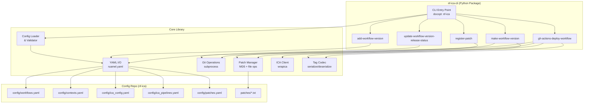

# Design Document

## Overview

nf-ica-cli is a Python CLI toolkit that orchestrates Nextflow pipeline deployments to Illumina Connected Analytics (ICA). It operates against a separate configuration repository (nf-ica) containing YAML config files and patch files.

The CLI exposes the command `nf-ica` with five subcommands:
- `register-patch` — Register a patch file by content hash for reuse across pipelines
- `add-workflow-version` — Register a new workflow version in workflows.yaml
- `make-workflow-version` — Create an annotated git tag encoding deployment metadata
- `update-workflow-version-release-status` — Transition a pipeline's release status
- `gh-actions-deploy-workflow` — Deploy a workflow version to ICA projects (GitHub Actions context)

The tool uses YAML as its primary data format, preserving comments and formatting across edits. Git annotated tags serve as the handoff mechanism between local operations and CI/CD deployment.

## Architecture



### Layered Architecture

The system follows a layered architecture:

1. **CLI Layer** — docopt-based command dispatch with usage strings as documentation. Thin layer that delegates to the core library.
2. **Core Library** — Business logic for config loading/validation, tag codec, patch management, git operations, and ICA API interaction via wrapica.
3. **I/O Layer** — File system access (ruamel.yaml for YAML, hashlib for MD5), git subprocess calls, wrapica for ICA API.

### Key Design Decisions

| Decision | Rationale |
|----------|-----------|
| docopt for CLI framework | Documentation-driven argument parsing; the usage string IS the documentation. Simple, explicit, no decorators needed |
| wrapica for ICA interactions | UMCCR's established Python wrapper for ICA API; handles authentication, pipeline CRUD, and project operations. Avoids reimplementing ICA API bindings |
| ruamel.yaml for YAML I/O | Preserves comments, formatting, and key order — critical for config repo readability |
| subprocess for git operations | Minimal dependencies; git CLI is always available in CI and dev environments |
| Content-addressed patch storage (MD5) | Deduplicates identical patches regardless of filename; deterministic paths |
| Tag message as YAML | Self-describing, parseable, consistent with the rest of the config repo |
| Config repo discovery via directory traversal | Allows CLI invocation from any subdirectory within the config repo |

## Components and Interfaces

### 1. CLI Entry Point (`nf_ica_cli/cli.py`)

The CLI uses docopt for documentation-driven argument parsing. The top-level usage string dispatches to subcommands, each with its own usage string.

```python
"""nf-ica CLI — Nextflow ICA pipeline orchestration.

Usage:
    nf-ica register-patch --file=<path> --name=<name> --description=<desc>
    nf-ica add-workflow-version --workflow-name=<name> --workflow-repo-uri=<uri>
            --workflow-version-tag=<tag> --workflow-version-git-commit-id=<id>
            --workflow-version-context=<ctx>... --workflow-ica-nextflow-version=<ver>
    nf-ica make-workflow-version --workflow-name=<name> --workflow-version-tag=<tag>
            --workflow-version-git-commit-id=<id> --workflow-version-context=<ctx>...
            [--workflow-patch-name=<patch>...] --release-status=<status>
            [--workflow-version-description=<desc>]
    nf-ica update-workflow-version-release-status --workflow-name=<name>
            --workflow-version-tag=<tag> --release-status=<status>
    nf-ica gh-actions-deploy-workflow --workflow-name=<name>
            --workflow-version=<ver> --annotated-tag-name=<tag>
    nf-ica -h | --help
    nf-ica --version

Options:
    -h --help     Show this help message
    --version     Show version
"""
from docopt import docopt
from pathlib import Path
import sys

def main() -> None:
    args = docopt(__doc__, version="nf-ica-cli 0.1.0", options_first=True)
    config_repo = find_config_repo()
    config = load_and_validate_config(config_repo)
    
    # Dispatch to subcommand handler
    if args["register-patch"]:
        handle_register_patch(args, config, config_repo)
    elif args["add-workflow-version"]:
        handle_add_workflow_version(args, config, config_repo)
    elif args["make-workflow-version"]:
        handle_make_workflow_version(args, config, config_repo)
    elif args["update-workflow-version-release-status"]:
        handle_update_release_status(args, config, config_repo)
    elif args["gh-actions-deploy-workflow"]:
        handle_deploy_workflow(args, config, config_repo)
```

Each subcommand handler extracts its typed arguments from the docopt dict and delegates to core library functions.

### 2. Config Loader & Validator (`nf_ica_cli/config.py`)

```python
from dataclasses import dataclass
from pathlib import Path
from typing import List, Optional

@dataclass
class WorkflowVersion:
    tag: str
    git_commit_id: str
    contexts: List[str]
    ica_nextflow_version: Optional[str] = None

@dataclass
class Workflow:
    name: str
    repo_uri: str
    versions: List[WorkflowVersion]

@dataclass
class Context:
    name: str
    description: str

@dataclass
class OidcAuth:
    aws_role_arn: str
    secret_arn: str

@dataclass
class IcaProject:
    id: str
    name: str
    oidc_auth: List[OidcAuth]
    contexts: List[str]

@dataclass
class Tenant:
    name: str
    id: str
    projects: List[IcaProject]

@dataclass
class IcaConfig:
    tenants: List[Tenant]
    default_nextflow_version: str

@dataclass
class PipelineEntry:
    workflow_name: str
    workflow_version: str
    git_commit_id: str
    pipeline_id: str
    release_status: str  # "DRAFT" | "RELEASED"
    tenants: List[str]
    contexts: List[str]
    patch_files: List[str]
    ica_nextflow_version: str

@dataclass
class PatchEntry:
    name: str
    path: str
    md5sum: str
    description: str

@dataclass
class AppConfig:
    config_repo: Path
    workflows: List[Workflow]
    contexts: List[Context]
    ica_config: IcaConfig
    pipelines: List[PipelineEntry]
    patches: List[PatchEntry]

def find_config_repo() -> Path:
    """Traverse CWD upward looking for directory with config/workflows.yaml."""
    ...

def load_and_validate_config(config_repo: Path) -> AppConfig:
    """Load all YAML files and validate structure/cross-references."""
    ...
```

**Validation rules** (per Requirement 6):
- Cross-reference context names against Contexts_Yaml
- Uniqueness checks on context names, patch names
- Field presence and type checks on all entries
- File existence checks for registered patches

### 3. YAML I/O (`nf_ica_cli/yaml_io.py`)

```python
from pathlib import Path
from ruamel.yaml import YAML

def load_yaml(path: Path) -> dict:
    """Load YAML preserving comments and formatting."""
    yaml = YAML()
    yaml.preserve_quotes = True
    with open(path) as f:
        return yaml.load(f)

def save_yaml(path: Path, data: dict) -> None:
    """Write YAML preserving comments and formatting."""
    yaml = YAML()
    yaml.preserve_quotes = True
    with open(path, 'w') as f:
        yaml.dump(data, f)
```

### 4. Tag Codec (`nf_ica_cli/tag_codec.py`)

```python
from dataclasses import dataclass
from typing import List

@dataclass
class TagMetadata:
    git_commit_id: str
    contexts: List[str]
    patch_names: List[str]
    release_status: str  # "DRAFT" | "RELEASED"
    workflow_version_description: str

def encode_tag_message(metadata: TagMetadata) -> str:
    """Serialize TagMetadata to YAML string for annotated tag message."""
    ...

def decode_tag_message(message: str) -> TagMetadata:
    """Deserialize annotated tag message YAML to TagMetadata."""
    ...

def make_tag_name(workflow_name: str, version_tag: str) -> str:
    """Generate tag name: <workflow-name>/<version-tag>__YYYYMMDDHHMMSS."""
    ...
```

### 5. Patch Manager (`nf_ica_cli/patches.py`)

```python
from pathlib import Path
import hashlib

def compute_md5(file_path: Path) -> str:
    """Compute MD5 hex digest of file contents."""
    ...

def register_patch(
    config_repo: Path,
    source_file: Path,
    name: str,
    description: str,
    existing_patches: List[PatchEntry],
) -> PatchEntry:
    """Register patch: compute MD5, copy if new, return entry."""
    ...

def apply_patches(
    repo_dir: Path,
    patch_names: List[str],
    patches_registry: List[PatchEntry],
    config_repo: Path,
) -> None:
    """Apply patches in order to a cloned repository."""
    ...
```

### 6. Git Operations (`nf_ica_cli/git_ops.py`)

```python
from pathlib import Path

def create_annotated_tag(
    repo_dir: Path,
    tag_name: str,
    message: str,
) -> None:
    """Create annotated git tag in the given repo."""
    ...

def tag_exists(repo_dir: Path, tag_name: str) -> bool:
    """Check if a tag already exists."""
    ...

def clone_at_commit(
    repo_uri: str,
    commit_id: str,
    target_dir: Path,
) -> None:
    """Shallow clone a repo and checkout specific commit."""
    ...

def get_tag_message(repo_dir: Path, tag_name: str) -> str:
    """Retrieve the message of an annotated tag."""
    ...
```

### 7. ICA Client (`nf_ica_cli/ica_client.py`)

Uses the `wrapica` library for all ICA API interactions. wrapica handles authentication, session management, and provides typed interfaces for pipeline operations.

```python
from dataclasses import dataclass
from pathlib import Path
from typing import Optional

from wrapica.project_pipelines import (
    ProjectPipeline,
    create_nextflow_pipeline_from_nf_core_zip,
    update_pipeline,
    get_project_pipeline_obj,
)
from wrapica.project import get_project_id_from_project_name
from wrapica.libica_models import ProjectPipelineCreateRequest


@dataclass
class DeploymentTarget:
    project_id: str
    project_name: str
    tenant_name: str
    aws_role_arn: str
    secret_arn: str


def authenticate_oidc(aws_role_arn: str, secret_arn: str) -> str:
    """Assume AWS role via OIDC, retrieve ICA JWT from Secrets Manager.
    
    Sets the wrapica session credentials for subsequent API calls.
    Returns the JWT token.
    """
    ...


def create_pipeline(
    project_id: str,
    workflow_name: str,
    version: str,
    source_dir: Path,
    nextflow_version: str,
    description: str,
) -> str:
    """Create a new Nextflow pipeline on ICA using wrapica.
    
    Zips the source directory and uploads via wrapica's pipeline creation API.
    Returns the pipeline_id.
    """
    ...


def update_existing_pipeline(
    project_id: str,
    pipeline_id: str,
    source_dir: Path,
    nextflow_version: str,
    description: str,
) -> None:
    """Update an existing pipeline on ICA using wrapica."""
    ...


def find_existing_pipeline(
    project_id: str,
    workflow_name: str,
    version: str,
) -> Optional[str]:
    """Check if a pipeline already exists for this workflow/version in the project.
    
    Returns pipeline_id if found, None otherwise.
    """
    ...
```

### 8. Release Page Generator (`nf_ica_cli/release_page.py`)

Uses snakemd to programmatically generate the GitHub Release page markdown body, and the GitHub CLI (`gh`) to create the release with artefacts.

```python
from dataclasses import dataclass
from pathlib import Path
from typing import List
import snakemd


@dataclass
class DeploymentResult:
    project_name: str
    project_id: str
    tenant_name: str
    pipeline_id: str
    contexts: List[str]


def generate_release_body(
    workflow_name: str,
    workflow_version: str,
    git_commit_id: str,
    workflow_version_description: str,
    release_status: str,
    nextflow_version: str,
    patch_names: List[str],
    deployments: List[DeploymentResult],
    skipped_projects: List[str],
) -> str:
    """Generate GitHub Release body as markdown using snakemd.
    
    The document includes:
    - Workflow name and version header
    - Git commit ID
    - Workflow version description (if provided)
    - Release status badge
    - Nextflow version
    - Table of deployed pipelines (project name, project ID, pipeline ID, contexts)
    - List of applied patches (if any)
    - List of skipped projects due to auth failures (if any)
    """
    doc = snakemd.new_doc()
    doc.add_heading(f"{workflow_name} v{workflow_version}", level=1)
    doc.add_paragraph(f"**Commit:** `{git_commit_id}`")
    if workflow_version_description:
        doc.add_paragraph(f"**Description:** {workflow_version_description}")
    doc.add_paragraph(f"**Release Status:** {release_status}")
    doc.add_paragraph(f"**Nextflow Version:** {nextflow_version}")
    
    # Deployment table
    doc.add_heading("Deployments", level=2)
    header = ["Project", "Tenant", "Pipeline ID", "Contexts"]
    rows = [
        [d.project_name, d.tenant_name, f"`{d.pipeline_id}`", ", ".join(d.contexts)]
        for d in deployments
    ]
    doc.add_table(header, rows)
    
    # Patches
    if patch_names:
        doc.add_heading("Applied Patches", level=2)
        doc.add_unordered_list(patch_names)
    
    # Skipped
    if skipped_projects:
        doc.add_heading("Skipped Projects (Auth Failure)", level=2)
        doc.add_unordered_list(skipped_projects)
    
    return str(doc)


def create_pipeline_zip(source_dir: Path, output_path: Path) -> Path:
    """Create a zip archive of the patched pipeline source.
    
    Returns the path to the created zip file.
    """
    ...


def create_github_release(
    tag_name: str,
    release_body: str,
    artefact_paths: List[Path],
) -> None:
    """Create a GitHub Release using the `gh` CLI.
    
    Attaches the pipeline zip and any other artefacts.
    Uses `gh release create <tag> --notes <body> <artefact_paths>...`
    """
    ...
```

## Data Models

### Configuration File Schemas

#### workflows.yaml
```yaml
workflows:
  - name: string          # Workflow name (e.g., "oncoanalyser")
    repo_uri: string      # Git repository URI
    versions:
      - tag: string               # Version tag (e.g., "2.2.0")
        git_commit_id: string     # Abbreviated or full hex commit hash (7-40 chars)
        contexts:                 # List of deployment contexts
          - string
        ica_nextflow_version: string  # Optional, overrides default
```

#### contexts.yaml
```yaml
contexts:
  - name: string          # Unique context name (e.g., "production")
    description: string   # Human-readable description
```

#### ica_config.yaml
```yaml
tenants:
  - name: string          # Tenant name
    id: string            # Tenant UUID
    projects:
      - id: string        # Project UUID
        name: string      # Project name
        oidc_auth:
          - aws_role_arn: string   # AWS role for OIDC
            secret_arn: string     # AWS Secrets Manager ARN for JWT
        contexts:
          - string        # Contexts this project serves
default_nextflow_version: string   # Default NF version for ICA pipelines
```

#### ica_pipelines.yaml
```yaml
pipelines:
  - workflow_name: string
    workflow_version: string
    git_commit_id: string
    pipeline_id: string           # ICA pipeline UUID
    release_status: string        # "DRAFT" | "RELEASED"
    tenants:
      - string
    contexts:
      - string
    patch_files:
      - string                    # Patch names (not file paths)
    ica_nextflow_version: string
```

#### patches.yaml
```yaml
patches:
  - name: string          # Unique identifier (alphanumeric, hyphens, underscores)
    path: string          # Relative path: "patches/<md5sum>.txt"
    md5sum: string        # MD5 hex digest of file contents
    description: string   # Human-readable description
```

#### Annotated Tag Message Schema
```yaml
git_commit_id: string                    # Non-empty hex commit hash
contexts:                                # One or more context names
  - string
patch_names:                             # Zero or more patch names
  - string
release_status: string                   # "DRAFT" | "RELEASED"
workflow_version_description: string     # May be empty string
```

### Tag Naming Convention

Format: `<workflow-name>/<workflow-version-tag>__YYYYMMDDHHMMSS`

Example: `oncoanalyser/2.2.0__20250715143022`

The timestamp ensures uniqueness when the same version is redeployed (e.g., with different patches or contexts).

## Correctness Properties

*A property is a characteristic or behavior that should hold true across all valid executions of a system — essentially, a formal statement about what the system should do. Properties serve as the bridge between human-readable specifications and machine-verifiable correctness guarantees.*

### Property 1: Tag codec round-trip

*For any* valid TagMetadata object (containing a non-empty git commit ID of 7-40 hex chars, a non-empty list of context strings, a list of zero or more patch name strings, a release status of "DRAFT" or "RELEASED", and a workflow version description string), encoding the metadata to a YAML tag message and then decoding that message back SHALL produce a TagMetadata object with identical field values.

**Validates: Requirements 7.4, 7.1, 7.2, 3.2**

### Property 2: YAML comment and formatting preservation

*For any* YAML document containing comments and specific formatting (key order, blank lines, quote styles), loading it with ruamel.yaml, modifying a value within the document, and writing it back SHALL preserve all comments and the relative ordering of unmodified keys.

**Validates: Requirements 2.8, 4.7, 5.11, 8.8**

### Property 3: Content-addressed patch storage determinism

*For any* file contents, the computed storage path (`patches/<md5sum>.txt`) is deterministic: identical file contents always produce the same MD5 and thus the same storage path, and different file contents produce different storage paths (with overwhelmingly high probability given MD5's collision resistance for this use case).

**Validates: Requirements 8.1, 8.2, 8.3**

### Property 4: Git commit ID validation

*For any* string, the git commit ID validator SHALL accept it if and only if it consists of exactly 7 to 40 characters from the set [a-f0-9].

**Validates: Requirements 2.7**

### Property 5: Patch name format validation

*For any* string, the patch name validator SHALL accept it if and only if it is non-empty and consists entirely of characters from the set [a-zA-Z0-9_-].

**Validates: Requirements 8.7**

### Property 6: Release status validation

*For any* string, the release status validator SHALL accept it if and only if it is exactly "DRAFT" or "RELEASED".

**Validates: Requirements 3.5, 4.3**

### Property 7: Context cross-reference validation

*For any* context value and a set of defined context names, the context validator SHALL reject the value with an error if and only if the value is not present in the defined set.

**Validates: Requirements 2.5, 3.7**

### Property 8: Config repo discovery

*For any* directory tree where exactly one ancestor directory (including the starting directory) contains `config/workflows.yaml`, invoking the config repo finder from any subdirectory at or below that ancestor SHALL return the path to that ancestor.

**Validates: Requirements 1.2**

### Property 9: Context-based project filtering

*For any* ICA configuration (set of tenants/projects with context lists) and any deployment context list, the project filter SHALL return exactly those projects whose context lists share at least one element with the deployment context list.

**Validates: Requirements 5.2**

### Property 10: Release status transition irreversibility

*For any* pipeline entry with `release_status` equal to "RELEASED", attempting to update the status to "DRAFT" SHALL be rejected with an error.

**Validates: Requirements 4.4**

### Property 11: Status update idempotence

*For any* pipeline entry, updating the release status to the value it already holds SHALL produce no changes to the YAML file and SHALL return a zero exit code.

**Validates: Requirements 4.5**

### Property 12: Configuration validation completeness

*For any* configuration structure (workflows, contexts, ICA config, pipelines, patches), the validator SHALL accept it if and only if all required fields are present, all cross-references (contexts, patch names) resolve to existing definitions, and all uniqueness constraints (context names, patch names) are satisfied.

**Validates: Requirements 1.5, 6.1, 6.2, 6.3, 6.4, 6.5**

### Property 13: Malformed tag message rejection

*For any* YAML document that is missing one or more of the five required keys (git_commit_id, contexts, patch_names, release_status, workflow_version_description), or contains a value with an incorrect type (e.g., string where list expected), the tag message parser SHALL reject it with an error identifying the problematic key.

**Validates: Requirements 7.3**

## Error Handling

### Error Categories

| Category | Exit Code | Example |
|----------|-----------|---------|
| Config not found | 1 | Config_Repo directory traversal fails |
| YAML parse error | 1 | Invalid YAML syntax in any config file |
| Validation error | 1 | Missing field, invalid cross-reference, uniqueness violation |
| Input validation | 1 | Invalid git commit ID, invalid patch name format |
| State violation | 1 | RELEASED → DRAFT transition, duplicate version |
| File access error | 1 | Patch file not readable, source file missing |
| Git operation error | 1 | Tag already exists, clone fails |
| ICA API error | 1 | Authentication failure, API call failure |
| Partial deployment | 1 | Some projects deployed, some skipped due to auth |

### Error Message Format

All error messages follow the pattern:
```
Error: [CATEGORY] description
  Context: specific details (file path, field name, etc.)
```

### Error Handling Strategy

1. **Fail fast on validation**: All input validation occurs before any side effects (file writes, API calls, tag creation).
2. **Atomic operations where possible**: YAML files are written only after all validations pass.
3. **Graceful degradation for deployment**: OIDC auth failures for individual projects are logged and skipped; deployment continues to other projects.
4. **Clear error attribution**: Every error message identifies the source (which file, which field, which value).

### Specific Error Behaviors

- **Config repo not found**: Lists expected directory structure to help user navigate.
- **YAML parse error**: Includes file path and line/column of syntax error from ruamel.yaml.
- **Cross-reference failure**: Lists the invalid value and the set of valid values.
- **Partial deployment**: Exit code 1 with summary of succeeded and failed projects.

## Testing Strategy

### Unit Tests (pytest)

Unit tests cover specific examples, edge cases, and error conditions:

- **Config loader**: Test with sample YAML files covering valid and invalid structures
- **CLI argument parsing**: Test docopt usage string parsing for valid and invalid argument combinations
- **Git operations**: Mock subprocess calls, verify correct commands
- **ICA client**: Mock wrapica functions, verify correct arguments passed to pipeline creation/update
- **Error messages**: Verify specific error message content and format

### Property-Based Tests (Hypothesis)

Property-based tests verify universal correctness properties across generated inputs. The project uses [Hypothesis](https://hypothesis.readthedocs.io/) as the PBT library.

**Configuration:**
- Minimum 100 iterations per property test
- Each property test references its design document property
- Tag format: `# Feature: nf-ica-cli, Property {number}: {property_text}`

**Properties to implement:**
1. Tag codec round-trip (Property 1)
2. YAML comment preservation (Property 2)
3. Content-addressed storage determinism (Property 3)
4. Git commit ID validation (Property 4)
5. Patch name validation (Property 5)
6. Release status validation (Property 6)
7. Context cross-reference validation (Property 7)
8. Config repo discovery (Property 8)
9. Context-based project filtering (Property 9)
10. Status transition irreversibility (Property 10)
11. Status update idempotence (Property 11)
12. Configuration validation (Property 12)
13. Malformed tag rejection (Property 13)

### Integration Tests

Integration tests verify end-to-end behavior with real file I/O and git operations:

- **register-patch workflow**: Create temp files, register, verify patches.yaml and file in patches/
- **add-workflow-version workflow**: Start with sample config repo, add version, verify YAML
- **make-workflow-version workflow**: Create tag, read it back, verify message content
- **gh-actions-deploy-workflow**: Mock ICA API, verify full deployment flow
- **update-workflow-version-release-status**: Verify status transitions in YAML

### Test Organization

```
tests/
├── unit/
│   ├── test_config.py
│   ├── test_tag_codec.py
│   ├── test_patches.py
│   ├── test_git_ops.py
│   ├── test_ica_client.py
│   └── test_validators.py
├── property/
│   ├── test_tag_codec_properties.py
│   ├── test_yaml_preservation.py
│   ├── test_patch_storage.py
│   ├── test_validators_properties.py
│   ├── test_config_discovery.py
│   ├── test_context_filter.py
│   ├── test_status_transitions.py
│   └── test_config_validation.py
└── integration/
    ├── test_register_patch_e2e.py
    ├── test_add_workflow_version_e2e.py
    ├── test_make_workflow_version_e2e.py
    ├── test_update_status_e2e.py
    └── test_deploy_workflow_e2e.py
```

### Dependencies

- **pytest** — test runner
- **hypothesis** — property-based testing
- **pytest-mock** — mocking for unit tests
- **pytest-tmp-files** or **tmp_path** fixture — temporary file system for integration tests

### Runtime Dependencies

- **docopt** — documentation-driven CLI argument parsing
- **ruamel.yaml** — comment-preserving YAML I/O
- **wrapica** — UMCCR's Python wrapper for ICA API (pipeline CRUD, authentication, project operations)
- **boto3** — AWS SDK for OIDC role assumption and Secrets Manager access (used by wrapica and auth flow)
- **snakemd** — programmatic Markdown document generation for GitHub Release pages

